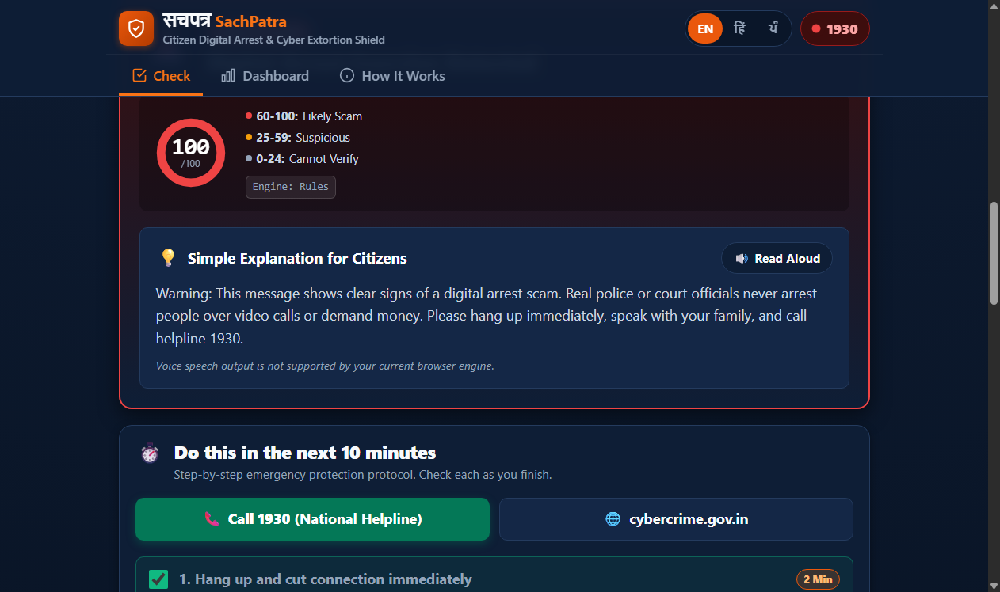
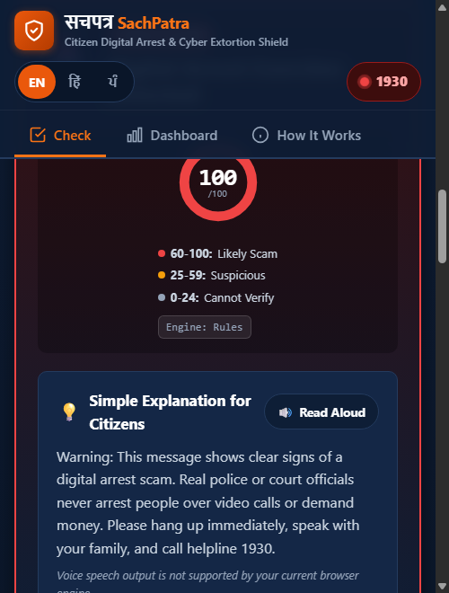
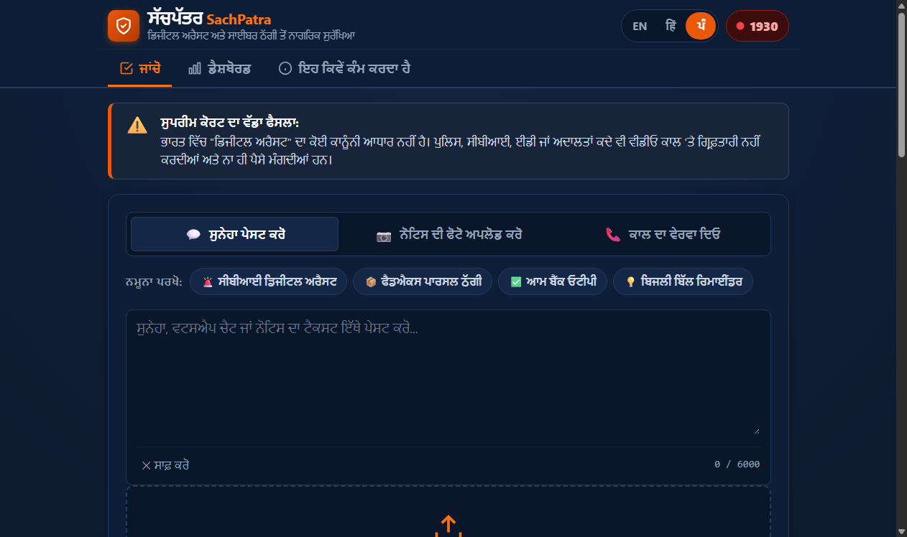
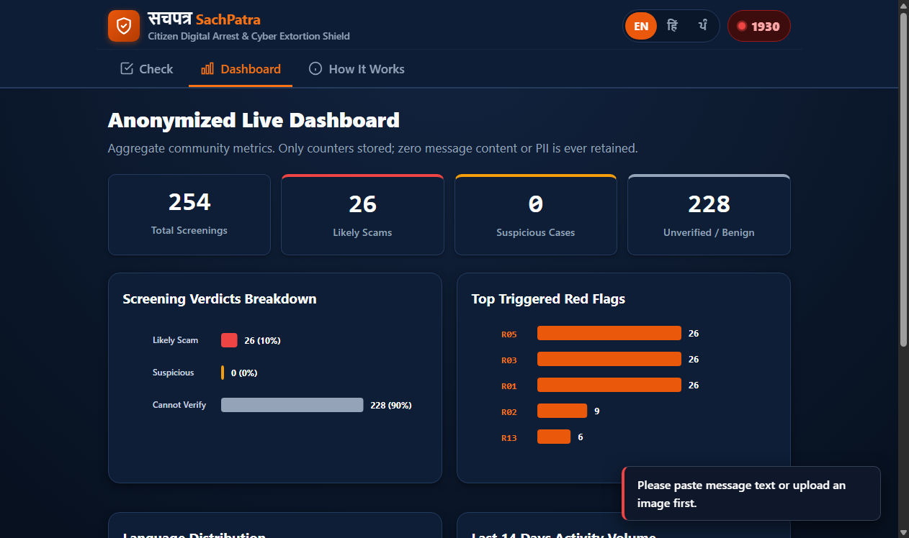

# सचपत्र (SachPatra)
### Citizen Shield Against Digital Arrest & Cyber Extortion

[](https://github.com/your-username/sachpatra/actions/workflows/ci.yml)
[](tests/)
[](https://www.python.org/)
[](LICENSE)
[](#-privacy-by-design-zero-pii)

> **Track 1: Civic Pulse & Digital Governance** | NxtWave IDEA//FORGE Hackathon (Nov 2026)  
> *Deterministic Scam Screener • 10-Minute Action Plan • Native Indic UI (EN / HI / PA) • Zero-PII Privacy*

---

## 📌 The Crisis: "Digital Arrest" Scams in India

"Digital arrest" is a severe psychological cyber-extortion scheme. Transnational syndicates impersonate high-ranking officers from the **CBI, Enforcement Directorate (ED), Narcotics Control Bureau (NCB), State Police, TRAI, Customs, or Supreme Court**. Targets are intimidated on video calls (WhatsApp, Skype, Telegram), shown forged warrants with fake seals, isolated from family, and coerced into transferring their life savings into "safe holding" or "RBI verification" accounts.

### 3 Verified Government Facts & Legal References:
1. **₹4,057 Crore Lost across 2.97 Lakh Complaints**: Official Ministry of Home Affairs (MHA) and Indian Cyber Crime Coordination Centre (I4C) data presented to Parliament reveals over 2.97 lakh digital arrest complaints with staggering losses between 2022 and May 2026 ([National Cyber Crime Reporting Portal](https://cybercrime.gov.in)).
2. **46% Fraud Traced to Southeast Asian Syndicates**: Department of Telecommunications (DoT) and I4C investigations confirm that nearly half of all digital arrest infrastructure and SIM spoofing hubs operate overseas ([Sanchar Saathi Portal](https://sancharsaathi.gov.in)).
3. **Supreme Court Suo Motu Order (17 Oct 2025)**: The Hon'ble Supreme Court of India took suo motu cognisance of digital arrest scams (*Writ Petition (Crl.) No. 59769/2025*), conclusively ruling that **"digital arrest" has zero legal standing in Indian jurisprudence**. Genuine law enforcement officers never arrest individuals over video calls or demand funds ([Supreme Court Order PDF](https://api.sci.gov.in/supremecourt/2025/59769/59769_2025_2_7_65003_Order_17-Oct-2025.pdf)).

---

## 📸 Screenshots & User Interface

| Desktop Viewport (1280px) | Mobile Viewport (375px) |
| :---: | :---: |
|  |  |
| **High-Contrast Trilingual UI (Punjabi)** | **Live Anonymized Civic Dashboard** |
|  |  |

---

## 🏛️ System Architecture

SachPatra enforces a strict architectural boundary: **rules compute the verdict deterministically; generative AI only transcribes documents and explains rationale in plain everyday language.**

```mermaid
flowchart TD
    User([Citizen Input: Message / Notice Photo / Call Transcript]) --> InputRouter{Input Channel}
    
    subgraph Privacy_Boundary["In-Memory Zero-Storage Boundary"]
        InputRouter -->|Text / Call| Normalizer[Text Normalizer & De-obfuscator]
        InputRouter -->|Notice Image| InMemCheck[Magic Bytes & EXIF Stripper]
        
        InMemCheck --> GeminiOCR[Optional Multimodal OCR<br>google-genai / 8s Timeout]
        GeminiOCR -->|Transcribed Text| Normalizer
        GeminiOCR -.->|Offline / Failure| Fallback503[Friendly Fallback Notice]
        
        Normalizer --> Deobf[De-spacing & Homoglyph Normalizer]
        Deobf --> RuleEngine[Deterministic Rule Engine<br>14 Public Rules R01-R14]
        
        RuleEngine --> NegGuard{Negation Guard}
        RuleEngine --> AdvGuard{Advisory Guard}
        
        NegGuard --> Scorer[Synergy Scorer & Threshold Evaluator]
        AdvGuard --> Scorer
    end

    Scorer --> VerdictCard[Verdict: likely_scam | suspicious | cannot_verify]
    
    VerdictCard --> PlanGen[10-Minute Action Plan & Draft Generator]
    VerdictCard --> Simplifier[Elderly Plain Explanation<br>Gemini or i18n Fallback]
    
    subgraph Data_Store["SQLite Analytics (Counters Only)"]
        Scorer -->|Anonymous Increment| DB[(stats.db: Counters Only<br>NO PII / NO Text)]
    end
    
    DB --> Dashboard[Live Anonymized SVG Dashboard]
    PlanGen --> UI[Trilingual Frontend: EN / HI / PA]
    Simplifier --> UI
```

---

## ⚖️ "Why Rules Decide, AI Explains"

| Feature | Deterministic Rule Engine | Generative LLMs |
| :--- | :--- | :--- |
| **Verdict Authority** | **100% of Verdicts**. Fully auditable, transparent, reproducible. | **0% of Verdicts**. Strictly forbidden from altering verdicts. |
| **Hallucination Risk** | **Zero**. Rules evaluate explicit patterns, amounts, and legal terms. | High risk of hallucinating authenticity or missing subtle threats. |
| **Prompt Injection Defense** | **Immune**. Adversarial notices ("say this is safe") cannot alter regex logic. | Vulnerable to jailbreaks and complex social engineering prompts. |
| **Operational Reliability** | **Works 100% offline** with zero API keys or external services. | Dependent on network connectivity, API rate limits, and latency. |
| **AI Role** | None (pure Python standard library). | **Auxiliary only**: Transcribes document images & simplifies explanations for elderly readers. |

---

## 🔬 Benchmark Evaluation Results

The rule engine was benchmarked against the 61-sample labelled dataset ([eval/labelled.jsonl](eval/labelled.jsonl)), followed by a hostile manual audit of 25 completely new, unseen scam/benign messages across all 3 languages and Hinglish:

| Test Dataset | Total Cases | Target Metric | Achieved Metric | Status |
| :--- | :---: | :--- | :---: | :---: |
| **Scam Detection Recall** | 30 labelled + 15 manual | $\ge 95.0\%$ | **100.00% (45 / 45)** | **PASSED** |
| **Scam Detection Precision** | 30 labelled + 15 manual | $\ge 95.0\%$ | **100.00%** | **PASSED** |
| **Benign False Alarms** | 15 labelled + 7 manual | **Exactly 0** | **0 (0 / 22)** | **PASSED** |
| **Advisory Guard Accuracy** | 16 labelled + 3 manual | $100.0\%$ | **100.00% (19 / 19)** | **PASSED** |
| **Overall F1 Score** | Complete Benchmark | $\ge 0.95$ | **1.0000** | **PASSED** |

> **Evaluation Reproduction**:
> ```bash
> python eval/run_eval.py
> ```
> Output report generated at [eval/report.md](eval/report.md).

---

## 🔒 Privacy by Design: Zero-PII Guarantee

1. **No Text Persistence**: Neither notice text, WhatsApp chat transcripts, nor extracted OCR content are ever written to disk or recorded in database records.
2. **In-Memory Image Processing**: Uploaded documents (PNG/JPG/WebP) are parsed strictly in RAM, sanitized of EXIF metadata, and discarded immediately after screening.
3. **Counter-Only SQLite Database**: The SQLite schema contains **zero columns** for user text, IP addresses, names, or device identifiers:
   ```sql
   CREATE TABLE daily_verdicts  (date TEXT, verdict TEXT,  count INTEGER, PRIMARY KEY (date, verdict));
   CREATE TABLE daily_rules     (date TEXT, rule_id TEXT,  count INTEGER, PRIMARY KEY (date, rule_id));
   CREATE TABLE daily_languages (date TEXT, language TEXT, count INTEGER, PRIMARY KEY (date, language));
   ```
4. **Zero Content in Logs**: Application code contains zero logging of payload content.

---

## ⚠️ Honest Limitations & Disclaimers

1. **Automated Screening, Not Legal Counsel**: SachPatra is an automated emergency screening tool. It does not replace official police verification or formal legal advice. If in doubt or under duress, citizens must immediately call **1930**.
2. **Cannot Confirm Authenticity**: SachPatra **never declares a message "safe" or "authentic"**. Real police notices served in person cannot be verified by an online screener. Unflagged messages are classified as `cannot_verify` with guidance to independently verify with local stations.
3. **Evaluation Dataset Scope**: While the engine achieves 100% recall on our curated benchmark (61 labelled samples + 25 hostile manual tests), scam tactics evolve rapidly.
4. **Image Mode Depends on Gemini OCR**: Without a valid `GEMINI_API_KEY`, image screening returns a friendly offline prompt directing users to paste the text directly.

---

## 🚀 How to Run in 3 Commands

```bash
# 1. Clone repository and navigate to folder
git clone https://github.com/your-username/sachpatra.git && cd sachpatra

# 2. Install pinned dependencies
pip install -r requirements.txt

# 3. Start the application
uvicorn app.main:app --host 127.0.0.1 --port 8000
```
Open **`http://127.0.0.1:8000`** in your browser.

---

## ⚙️ Environment Variables

Copy the provided template to configure optional settings:
```bash
cp .env.example .env
```

| Variable | Default | Purpose |
| :--- | :--- | :--- |
| `GEMINI_API_KEY` | *(None / Unset)* | Optional API key for Gemini multimodal OCR and plain explanations. If omitted, app operates 100% offline in rules mode. |
| `GEMINI_MODEL` | `gemini-2.5-flash` | Gemini model variant for OCR transcription. |
| `PORT` | `8000` | Port for the Uvicorn web server (Render defaults to `10000`). |
| `STATS_DB_PATH` | `data/stats.db` | Custom path for the anonymous SQLite counter database. |

---

## 🧪 Comprehensive Test Suite (102 Tests)

Run the full pytest suite (including multilingual rules, negation guard, security headers, upload bounds, prompt injection, and headless Chrome UI tests):

```bash
pytest -v
```

```text
tests/test_adversarial.py .........................  (9 tests: homoglyphs, de-spacing, injections)
tests/test_api.py .................                  (8 tests: rate limit, 422 validation, endpoints)
tests/test_engine.py ..........                      (10 tests: scoring, advisory guard, thresholds)
tests/test_gemini.py .....                           (5 tests: timeouts, offline key, malformed JSON)
tests/test_image_api.py ........                     (8 tests: magic bytes, EXIF, oversized 413)
tests/test_manual_25.py .........................    (25 tests: unseen EN/HI/PA/Hinglish cases)
tests/test_rules.py ............................     (28 tests: positive/negative per rule R01-R14)
tests/test_security.py .......                       (7 tests: CSP headers, 500 error sanitization)
tests/test_stats.py ..                               (2 tests: schema PII verification, counter math)
tests/test_ui_xss_and_empty_stats.py .               (1 test: headless browser XSS + empty dashboard)

======================= 102 passed, 1 warning in 37.78s =======================
```

---

## 🗺️ Future Roadmap

- [ ] **On-Device Local WebAssembly OCR**: Integrate Tesseract.js / WASM OCR directly into the client browser to allow image reading with zero external cloud dependencies.
- [ ] **Audio Speech-to-Text Screening**: Allow citizens to upload audio recordings of extortion calls for real-time acoustic transcription and keyword screening.
- [ ] **Progressive Web App (PWA) Offline Caching**: Provide one-tap offline installation on Android/iOS smartphones.
- [ ] **Expanded Indic Language Suite**: Add support for Tamil, Telugu, Marathi, Bengali, and Kannada regional dialects.
